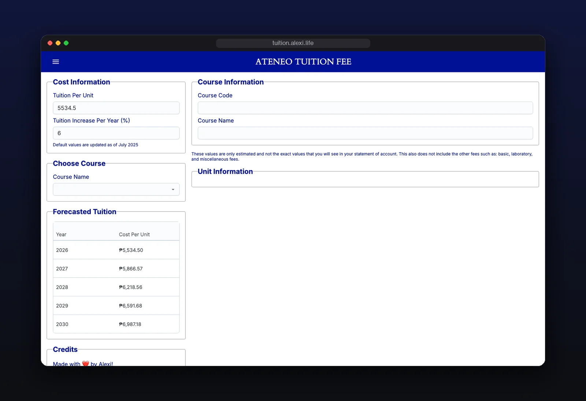

<div align="center">

<br>

# Ateneo Tuition Calculator

**See what your Ateneo tuition will cost, this year and every year after.**

Pick your course and get a forecast through graduation.

<a href="https://tuition.alexi.life">tuition.alexi.life</a> ·
<a href="#features">Features</a> ·
<a href="#run-it-locally">Run it locally</a>

<br>


<br>



</div>

<br>

## Features

- **Your course, pre-filled.** Pick a course and see its units and tuition per term.
- **Forecast to graduation.** Tuition per unit, projected year by year.
- **Your own assumptions.** Adjust the rate per unit and the yearly increase. Defaults are kept up to date.

<br>

## Run it locally

Next.js · Redux Toolkit · MUI Joy · a Python curriculum scraper

<details>
<summary><b>Setup</b></summary>
<br>

```bash
npm install
npm run dev
```

</details>

<br>

<div align="center">
<sub>estimates only, excluding basic, laboratory and miscellaneous fees · not affiliated with Ateneo de Manila University</sub>
</div>
